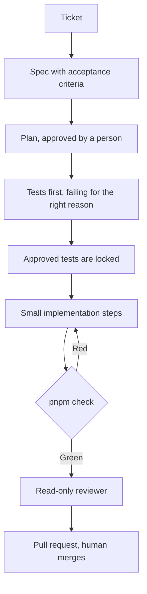

# Forkcast

Forkcast is an AI meal planner. You tell it what you eat and what you cannot eat. It drafts a week of meals and a shopping list grouped for the shop.

The planner itself is the next piece of work. This repository is the harness it will be built in: one process, shared by Claude Code and Cursor, where a person approves the spec, the plan, and the tests, and a hook decides when the agent is allowed to stop.

## The workflow



Labels on the issue are the state machine: `needs-spec`, then `spec:approved`, then `agent:ready` (the owner sets that last one), then a pull request. Agents do not merge. Issue and pull request titles look like `feat: Meal preferences form`. The pull request body contains `Closes #N`.

The longer version, including what is enforced by a hook and what is only an instruction, is in [docs/workflow.md](docs/workflow.md).

## Run it

Requirements: Node.js 22 or newer, pnpm 10, and a bash shell for the hooks.

```bash
pnpm install
pnpm check
pnpm dev
```

`pnpm check` is the gate: generate Next.js route types, `tsc --noEmit`, ESLint, and Vitest.

```bash
pnpm exec playwright install chromium
pnpm e2e
```

`pnpm e2e` is the Playwright smoke test (the home page renders). It is not part of `pnpm check`. In CI it runs against `pnpm start` after the production build.

```bash
pnpm format
bash scripts/verify-hooks.sh
```

`pnpm format` is Prettier. It is not part of the gate. `scripts/verify-hooks.sh` proves the quality gate and the test lock. It rewrites a test file temporarily and restores it.

## Roadmap

1. Preferences form: diet, allergies, servings.
2. AI weekly plan, streamed.
3. Swap a dish, with an optimistic UI.
4. Shopping list, grouped.
5. Auth and Postgres.
6. End-to-end coverage of those flows.
7. Deploy to Vercel.
8. Stripe in test mode.

## Layout

| Path                                | What it is                         |
| ----------------------------------- | ---------------------------------- |
| `src/app`                           | Next.js App Router                 |
| `src/lib/format-servings.ts`        | Small test-first example           |
| `src/components/kitchen-status.tsx` | Small component test that uses MSW |
| `docs/specs/TEMPLATE.md`            | Spec template                      |
| `.github/labels.yml`                | Workflow labels                    |
| `AGENTS.md`                         | Map for both agents                |
