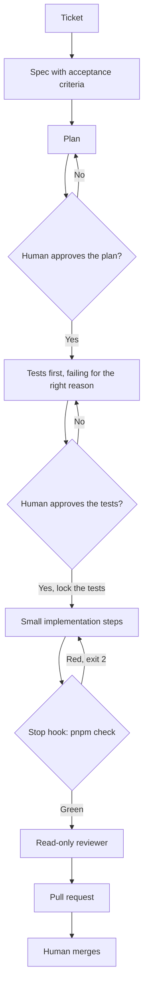

# How Forkcast is built

Forkcast is an AI meal planner: preferences and allergies in, a weekly plan and a shopping list out. The product features are not in the repo yet. What is here is the process used to build them, the same way in Claude Code and in Cursor.

The model writes code. The harness decides when the work is allowed to count as done. A person approves the spec, the plan, the tests, and the merge.

## The cycle



1. **Issue, then spec.** `/issue` turns a rough description into a GitHub Issue Form draft and, after the user confirms, opens it with only `type:*` and `needs-spec`. `/spec` copies that issue into `docs/specs/<issue-number>-<slug>.md`, in the same section order. If the criteria cannot be tested yet, the agent asks (at most three questions) instead of guessing.
2. **Plan.** The agent reads the code and lists steps, files, and tests. It does not edit. A person edits the plan before any code.
3. **Tests first.** `/tdd` writes tests from the acceptance criteria and runs them. They must fail because the behaviour is missing, not because of a typo. A person accepts that commit (`test: ...`) and the agent creates `.claude/tests.lock`.
4. **Small steps.** One plan step at a time. While the lock file exists, a PreToolUse hook blocks edits to test files.
5. **Quality gate.** When the agent tries to stop, a hook runs `pnpm check` (types, lint, unit tests). Red: the hook returns exit 2 and the agent keeps working. The gate stays off until the lock exists, because a red suite is the point of the test-first step.
6. **Review.** A subagent that did not write the code, and that cannot edit, checks the diff against the spec. Then a person reads the diff.
7. **Pull request.** `/pr-ready` fills in the PR from the spec and the command output. The PR title is the issue title. The body contains `Closes #N`. A person merges.

## Issue labels

Labels are a state machine, not sticky notes. The catalog is `.github/labels.yml` (name, color, description). That file documents labels that already exist. Nothing in CI creates or edits them.

| Label                                    | Who moves it     | Meaning                                             |
| ---------------------------------------- | ---------------- | --------------------------------------------------- |
| `needs-spec`                             | Issue templates  | Acceptance criteria are missing or not reviewed yet |
| `spec:approved`                          | Owner            | The spec is accepted                                |
| `agent:ready`                            | Owner only       | An agent may start work                             |
| `agent:cursor`, `agent:claude`           | Owner            | Which tool should pick the issue up                 |
| `type:feature`, `type:bug`, `type:chore` | Templates, owner | Kind of work                                        |
| `risk:low`, `risk:high`                  | Owner            | How carefully a human should review the PR          |

The path is `needs-spec`, then `spec:approved`, then `agent:ready`, then a PR, then a human merge. Agents never add or remove `agent:ready`, `spec:approved`, or `risk:*`, and they never merge.

`agent:ready` is the owner's switch. An instruction in a prompt can be ignored. A label the agent is forbidden to set cannot be switched on by the same agent that wants to start coding. That is the same idea as the test lock: the phase change is a human action.

`risk:high` is for a PR that touches the harness (`.claude`, `.cursor`, `.github`, `AGENTS.md`, `CLAUDE.md`), AI prompts, schemas, dependencies, or secrets. `risk:low` is a small, well-tested product change. The agent names the risk in the PR. The owner applies the label.

A bug is `type:bug`. The first commit is a regression test that fails on `main`.

Feature and bug issues are GitHub Issue Forms (`.github/ISSUE_TEMPLATE/`). Blank issues are off. Both forms open with `needs-spec`, so a ticket cannot look ready by accident. The form fields and `docs/specs/TEMPLATE.md` use the same section order.

## Titles

Issues, pull requests, and commit subjects use `<type>: <short imperative summary>`.

| Type       | Use                                                          |
| ---------- | ------------------------------------------------------------ |
| `feat`     | New behaviour                                                |
| `fix`      | A bug                                                        |
| `chore`    | Tooling or config that is not a user-facing behaviour change |
| `docs`     | Documentation only                                           |
| `test`     | Tests only, including the approved red-test commit           |
| `refactor` | Behaviour-preserving restructure                             |
| `ci`       | GitHub Actions and the check pipeline                        |

Examples: `feat: Meal preferences form`, `fix: Plan ignores nut allergy`. No trailing period. The pull request title is the same string as the issue title, and the body contains `Closes #N`.

CI rejects any other pull request title. The check is `scripts/check-pr-title.mjs`, run inline from the workflow with `contents: read`. It is not a marketplace action.

## What the harness enforces

Instructions (`AGENTS.md`, skills) can be interpreted loosely. Hooks run even when the model would rather skip them.

| Always                                     | Where                                          |
| ------------------------------------------ | ---------------------------------------------- |
| Lint the file that was just edited         | PostToolUse hook                               |
| Refuse edits to approved tests             | PreToolUse hook plus `.claude/tests.lock`      |
| Refuse to finish while `pnpm check` is red | Stop hook, exit 2                              |
| Reviewer cannot edit                       | `tools: Read, Grep, Glob` and `readonly: true` |
| Secrets stay unread                        | Claude deny rules for `.env` and `.env.*`      |
| Merge                                      | A person, after CI                             |

Cursor uses the same scripts. Its stop hook sends a follow-up message instead of using exit 2, because that is how Cursor continues a turn. `loop_limit` stops the loop after five follow-ups. See `.cursor/hooks.json`.

## Tests, with judgment

| Change                     | Write first                                    |
| -------------------------- | ---------------------------------------------- |
| Logic, validation          | A unit test                                    |
| A React hook               | A `renderHook` test                            |
| A bug                      | A regression test that fails on `main`         |
| A component with behaviour | A Testing Library test, not a snapshot         |
| A critical user flow       | A Playwright test                              |
| Visual layout only         | No unit test. A browser check, named in the PR |

`src/lib/format-servings.ts` is a tiny example of the unit-test shape. `src/components/kitchen-status.tsx` is a tiny example of a component test that goes through MSW. Neither is a product feature. The home page is covered by one Playwright smoke test.

Component tests talk to the network the way the component does. MSW answers `fetch` in jsdom. There is no service worker, because these tests do not run in a browser tab.

## Commands

```bash
pnpm install
pnpm check
pnpm build
pnpm exec playwright install chromium
pnpm e2e
bash scripts/verify-hooks.sh
```

`pnpm check` is `next typegen && tsc --noEmit && eslint . && vitest run`. Next.js 16 does not commit `next-env.d.ts`, so typegen has to run before `tsc`. CI runs the same check, then `pnpm build`, then Playwright.

## Process metrics

Not measured yet. Fill this in from real tickets. Do not invent numbers for a README, a pull request, or an interview.

| Signal                                 | What to count                                                                     | Value |
| -------------------------------------- | --------------------------------------------------------------------------------- | ----- |
| Specs merged                           | Files under `docs/specs/` besides the template                                    | —     |
| Tests that failed for the wrong reason | Red runs caused by a typo, a bad import, or the harness                           | —     |
| Quality-gate blocks                    | Stop-hook runs that exited 2                                                      | —     |
| Approved tests edited later            | Test files changed after the `test:` commit. Should stay 0 unless a person agreed | —     |
| Reviewer findings                      | Gaps the read-only reviewer reported before a person read the diff                | —     |
