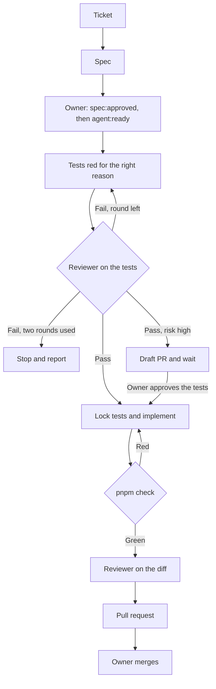

# How Forkcast is built

Forkcast is an AI meal planner: preferences and allergies in, a weekly plan and a shopping list out. The product features are not in the repo yet. What is here is the process used to build them, the same way in Claude Code and in Cursor.

The model writes code. The harness decides when the work is allowed to count as done. The owner approves the spec and the merge. After `agent:ready`, the reviewer accepts the tests and the agent implements in the same run. `risk:high` work still waits for the owner to approve the tests.

## The cycle



1. **Issue, then spec.** `/issue` turns a rough description into a GitHub Issue Form draft and, after the user confirms, opens it with only `type:*` and `needs-spec`. `/spec` copies that issue into `docs/specs/<issue-number>-<slug>.md`, in the same section order. If the criteria cannot be tested yet, the agent asks (at most three questions) instead of guessing. The owner approves that spec (`spec:approved`) and later sets `agent:ready`. There is no separate plan approval.
2. **Tests first.** `/tdd` writes tests from the acceptance criteria and runs them. They must fail because the behaviour is missing, not because of a typo or a bad import. The agent keeps the failure summary and does not read the full log. The read-only reviewer then checks the tests against the spec: every criterion has a test, the tests are red for the right reason, and they assert behaviour rather than implementation. The reviewer returns pass or fail.
3. **Reviewer pass, default.** The agent commits `test: <short imperative summary>`, creates `.claude/tests.lock` (gitignored; one line, the spec path), and implements in the same run. It does not wait for the owner.
4. **Reviewer fail.** The agent fixes the tests and asks the reviewer again. At most two fix rounds. If the reviewer still fails, the agent stops and reports the gaps. It does not create the lock and does not implement.
5. **`risk:high` exception.** Work that touches the harness (`.claude`, `.cursor`, `.github`, `AGENTS.md`, `CLAUDE.md`), AI prompts, auth, payments, schemas, dependencies, or secrets keeps the two-phase flow. After the reviewer passes the red tests, the agent commits them, opens a draft pull request, and stops. The owner approves the tests. Only then does the agent create the lock and implement. The agent names `risk:high` in the pull request and does not apply the label.
6. **Small steps.** One step at a time. While the lock file exists, a PreToolUse hook blocks edits to test files.
7. **Quality gate.** When the agent tries to stop, a hook runs `pnpm check` (types, lint, unit tests). Red: the hook returns exit 2 and only the failure lines, and the agent keeps working. The gate stays off until the lock exists, so the red test-first step is not forced green early.
8. **Review the diff.** The same read-only reviewer checks the implementation against the spec. It fails the diff when a test file changed and the spec did not, and when a new dependency is not allowed by `docs/tech-stack.md`.
9. **Pull request.** `/pr-ready` runs after implementation, when `.claude/tests.lock` exists. It does not run on a `risk:high` draft that is still waiting for the owner. The title is the issue title. The body contains `Closes #N` and the sections Spec, What changed, Evidence, Why, Risk, Out of scope. If that approved work already has a draft, update it and mark it ready. The owner merges.

An approved test changes only together with a spec change the owner has approved. While `.claude/tests.lock` exists, the hook refuses every test edit. The owner's approval does not open the hook. Delete the lock, update the spec and the tests in the same change, ask the reviewer to check those tests, then create the lock again before more implementation. `/pr-ready` also deletes the lock after the pull request is open. Do not delete the lock to make a red suite pass. A test change with no spec change is a fail.

Agents never add or remove `agent:ready`, `spec:approved`, or `risk:*`, and they never merge.

## Issue labels

Labels are a state machine, not sticky notes. The catalog is `.github/labels.yml` (name, color, description). That file documents labels that already exist. Nothing in CI creates or edits them.

| Label                                    | Who moves it     | Meaning                                             |
| ---------------------------------------- | ---------------- | --------------------------------------------------- |
| `needs-spec`                             | Issue templates  | Acceptance criteria are missing or not reviewed yet |
| `spec:approved`                          | Owner            | The spec is accepted                                |
| `agent:ready`                            | Owner only       | An agent may start work                             |
| `agent:cursor`, `agent:claude`           | Owner            | Which tool should pick the issue up                 |
| `type:feature`, `type:bug`, `type:chore` | Templates, owner | Kind of work                                        |
| `risk:low`, `risk:high`                  | Owner            | How carefully a human should review the PR          |

The path is `needs-spec`, then `spec:approved`, then `agent:ready`, then tests, then a pull request, then the owner merges. Agents never add or remove `agent:ready`, `spec:approved`, or `risk:*`, and they never merge.

`agent:ready` is the owner's switch. An instruction in a prompt can be ignored. A label the agent is forbidden to set cannot be switched on by the same agent that wants to start coding. That is the same idea as the test lock: the phase change is a human action. After that switch, the default run does not stop again for the owner until merge. `risk:high` is the exception, and it stops for test approval.

`risk:high` is for a pull request that touches the harness (`.claude`, `.cursor`, `.github`, `AGENTS.md`, `CLAUDE.md`), AI prompts, auth, payments, schemas, dependencies, or secrets. A dependency that `docs/tech-stack.md` does not allow needs the owner's explicit approval before it is added, and that addition is `risk:high`. `risk:low` is a small, well-tested product change. The agent names the risk in the pull request. The owner applies the label. The agent decides which flow to use from that list, before the label exists.

A bug is `type:bug`. The first commit is a regression test that fails on `main`.

Feature and bug issues are GitHub Issue Forms (`.github/ISSUE_TEMPLATE/`). Blank issues are off. Both forms open with `needs-spec`, so a ticket cannot look ready by accident. The form fields and `docs/specs/TEMPLATE.md` use the same section order.

## Titles

Issues, pull requests, and commit subjects use `<type>: <short imperative summary>`.

| Type       | Use                                                          |
| ---------- | ------------------------------------------------------------ |
| `feat`     | New behaviour                                                |
| `fix`      | A bug                                                        |
| `chore`    | Tooling or config that is not a user-facing behaviour change |
| `docs`     | Documentation only                                           |
| `test`     | Tests only, including the approved red-test commit           |
| `refactor` | Behaviour-preserving restructure                             |
| `ci`       | GitHub Actions and the check pipeline                        |

Examples: `feat: Meal preferences form`, `fix: Plan ignores nut allergy`. No trailing period. The pull request title is the same string as the issue title, and the body contains `Closes #N`.

CI rejects any other pull request title. The check is `scripts/check-pr-title.mjs`, run inline from the workflow with `contents: read`. It is not a marketplace action.

## What the harness enforces

Instructions (`AGENTS.md`, skills) can be interpreted loosely. Hooks run even when the model would rather skip them.

| Always                                     | Where                                                        |
| ------------------------------------------ | ------------------------------------------------------------ |
| Lint the file that was just edited         | PostToolUse hook                                             |
| Refuse edits to approved tests             | PreToolUse hook plus `.claude/tests.lock`                    |
| Refuse to finish while `pnpm check` is red | Stop hook, exit 2                                            |
| Return only failures                       | Stop hook prints failure lines; success is silent            |
| Reviewer cannot edit                       | `tools: Read, Grep, Glob`, `readonly: true`, `model: haiku`  |
| Secrets stay unread                        | Claude deny rules for `.env` and `.env.*`                    |
| Merge                                      | The owner, after CI                                          |

Cursor uses the same scripts. Its stop hook sends a follow-up message instead of using exit 2, because that is how Cursor continues a turn. `loop_limit` stops the loop after five follow-ups. See `.cursor/hooks.json`.

## Models and cost

Use a cheap model for review. Use a strong model for a run that implements, and for architecture, hard bugs, and AI prompts.

A default `/tdd` run writes the tests and implements in the same agent. That agent is the strong model. The reviewer is a different agent and stays cheap. A cheap model writes mechanical tests only when that agent does not implement. Cursor chooses the model once per agent, so do not assign a cheap model to the run that also implements.

| Work                                                         | Model                                                                                          |
| ------------------------------------------------------------ | ---------------------------------------------------------------------------------------------- |
| Review of red tests, or of the diff                          | Cheap. Claude Code: `model: haiku` in `.claude/agents/reviewer.md`. Cursor: the reviewer agent |
| `/tdd` through implementation, architecture, hard bugs       | Strong. One model for that whole agent                                                        |
| Mechanical tests from a finished spec, and no implementation | Cheap                                                                                          |
| AI prompts                                                   | Strong, and the work is `risk:high`                                                            |

Cursor does not read `model:` from the Claude agent file. In Cursor the model is chosen per agent, when that agent starts.

`pnpm check` and `pnpm e2e` run the suites. CI runs them again. The model does not read a full passing log. A local run keeps the failure summary only (failing names and assertion errors). Hooks print nothing when the command passes. On failure they return only the failure lines.

## Unattended runs

A night queue takes issues labeled `agent:ready` one at a time. Each issue gets its own pull request. A run opens at most five pull requests, then stops even when more issues are ready.

`docs/progress.md` on `main` is the empty template. The live notes are on the current issue branch. Before taking a new issue, read `docs/progress.md` from the open pull request that was updated most recently. Resume that branch only when its status is `blocked` or `in progress`. An empty status is the template. `done` means that issue's pull request is open and the queue may take the next issue. When a pull request merges, keep the template from `main`.

On a default issue, follow `/tdd` (tests, reviewer, lock, implementation) and then `/pr-ready`. The owner already set `agent:ready`. Do not wait for a slash command.

If `/tdd` stops, the run stops. That includes a reviewer fail after two rounds and a `risk:high` draft waiting for the owner's test approval. Do not run `/pr-ready` after that stop. `/pr-ready` would treat the intentional red suite as a bug to fix and would mark the draft ready before the owner has approved the tests.

Other blockers are a missing spec, tests that stay red for the wrong reason, and a red `pnpm check` the agent cannot fix. Do not start the next issue.

Before it stops, write the current issue, status, branch, pull request, blocker, and next step into `docs/progress.md` on that issue branch, commit it, and push the branch. The next session reads that branch, not the template on `main`.

## Tests, with judgment

| Change                     | Write first                                    |
| -------------------------- | ---------------------------------------------- |
| Logic, validation          | A unit test                                    |
| A React hook               | A `renderHook` test                            |
| A bug                      | A regression test that fails on `main`         |
| A component with behaviour | A Testing Library test, not a snapshot         |
| A critical user flow       | A Playwright test                              |
| Visual layout only         | No unit test. A browser check, named in the PR |

`src/lib/format-servings.ts` is a tiny example of the unit-test shape. `src/components/kitchen-status.tsx` is a tiny example of a component test that goes through MSW. Neither is a product feature. The home page is covered by one Playwright smoke test.

Component tests talk to the network the way the component does. MSW answers `fetch` in jsdom. There is no service worker, because these tests do not run in a browser tab.

## Commands

```bash
pnpm install
pnpm check
pnpm build
pnpm exec playwright install chromium
pnpm e2e
bash scripts/verify-hooks.sh
```

`pnpm check` is `next typegen && tsc --noEmit && eslint . && vitest run`. Next.js 16 does not commit `next-env.d.ts`, so typegen has to run before `tsc`. CI runs the same check, then `pnpm build`, then Playwright.

## Process metrics

Not measured yet. Fill this in from real tickets. Do not invent numbers for a README, a pull request, or an interview.

| Signal                                 | What to count                                                                     | Value |
| -------------------------------------- | --------------------------------------------------------------------------------- | ----- |
| Specs merged                           | Files under `docs/specs/` besides the template                                    | —     |
| Tests that failed for the wrong reason | Red runs caused by a typo, a bad import, or the harness                           | —     |
| Quality-gate blocks                    | Stop-hook runs that exited 2                                                      | —     |
| Approved tests edited later            | Test files changed after the `test:` commit. Should stay 0 unless the owner approved a spec change | —     |
| Reviewer findings                      | Gaps the read-only reviewer reported before a person read the diff                | —     |
